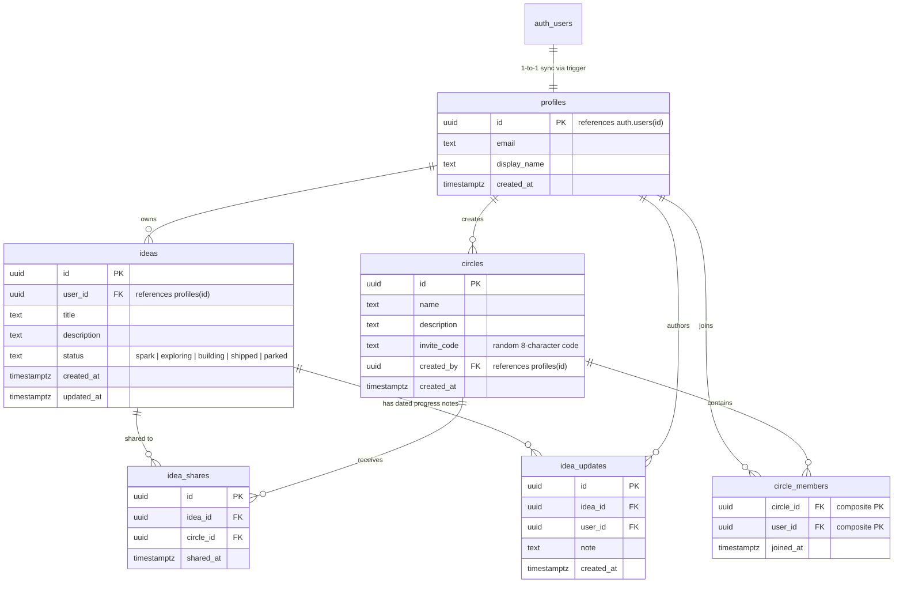

# Idea Circles 💡⭕

A portfolio web application where creators capture raw ideas, track their lifecycle progress, and share them with trusted friends inside invite-code circles.

Built with **Next.js (App Router)**, **TypeScript**, **Tailwind CSS**, and **Supabase (PostgreSQL & Row Level Security)**, deployed on **Vercel**.

---

## Database Architecture & Diagram

The database uses PostgreSQL managed by Supabase, strictly secured with **Row Level Security (RLS)** on all tables.



---

## Security & Access Control (Row Level Security)

Every database table enforces Row Level Security at the PostgreSQL engine level:

1. **Ideas Privacy**:
   - Only the idea creator can edit or delete an idea (`auth.uid() = user_id`).
   - An idea is visible **only** to the author OR members of circles where the idea has been explicitly shared.
   - Non-members receive `0` rows from PostgreSQL, resulting in an immediate `404 Not Found`.
2. **Circles & Membership**:
   - Circles and member lists can only be viewed by members of that circle.
   - Joining a circle requires an unguessable 8-character invite code via the secure PostgreSQL function `join_circle_with_code`.
3. **Progress Notes**:
   - Only the idea owner can post or delete dated progress notes.
   - Circle members can read progress notes for shared ideas.

---

## Local Development Setup

### 1. Clone & Install Dependencies
```bash
git clone <your-repo-url>
cd idea-circles
npm install
```

### 2. Configure Environment Variables
Copy `.env.example` to `.env.local`:
```bash
cp .env.example .env.local
```
Fill in your Supabase credentials:
```env
NEXT_PUBLIC_SUPABASE_URL=https://your-project.supabase.co
NEXT_PUBLIC_SUPABASE_ANON_KEY=your-anon-key
```

### 3. Run Database Migrations
Copy the SQL from `supabase/schema.sql` and run it in your **Supabase Dashboard &rarr; SQL Editor**.

### 4. Start the Local Server
```bash
npm run dev
```
Open [http://localhost:3000](http://localhost:3000) in your browser.

### 5. Run Security Tests
```bash
npm test
```

---

## Features Implemented (Version 1)

1. **Authentication**: Email & password authentication with automatic profile creation via database trigger.
2. **Ideas CRUD**: Create, list, edit, and delete ideas with 5 structured lifecycle statuses (`spark`, `exploring`, `building`, `shipped`, `parked`).
3. **Private Circles**: Create circles, generate random 8-character invite codes, join by code, see member lists, and leave.
4. **Idea Sharing**: Selectively share an idea into one or more circles.
5. **Dated Progress Notes**: Post chronological milestones with timestamps.
6. **Circle Feed**: Single circle page listing every shared idea with its status badge and latest note.
7. **Responsive & Accessible**: Mobile-friendly layouts, skeleton loading states, error boundaries, custom 404, and input constraints.
